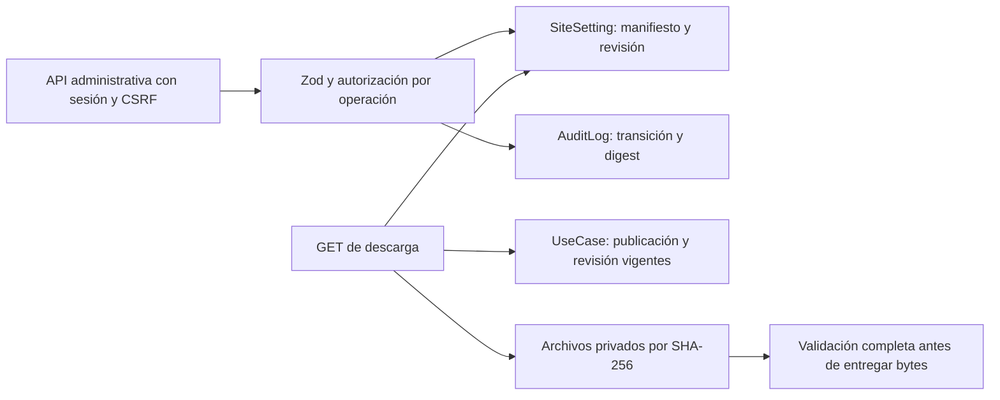

# Blueprint Engine — entrega 1, backend

29-10-2026. Base aprobada y conservada: main `9a824bf833712a3ab44fac12e7c7289f96d9aa07`, CI 40733346624. Sin componentes de interfaz, workflows completos, servicios externos o escrituras en Neon. Las pruebas crean exclusivamente DB, usuarios y archivos desechables locales.

## Arquitectura y persistencia

El modelo existente UseCase tiene slug único, estado editorial, isDemo, publishedAt, updatedAt y relaciones con herramientas/categorías/tags/artículos. No contiene campos de archivos. Se conserva íntegro; el blueprint se asocia por slug y fija su updatedAt al verificarse. La guía no se edita desde este módulo. Guías retiradas, demo, futuras, eliminadas o modificadas dejan de autorizar la descarga.

Cada versión ocupa una clave privada `blueprint.release.<id>@<version>` en **SiteSetting**, con manifiesto Zod, estado, revisión optimista y attestaciones de servidor. **AuditLog** conserva actor, operación, revisión y digest, sin bytes, rutas privadas o credenciales. Ambos cambios son atómicos; bloqueo transaccional por clave impide escritores concurrentes. No se reutilizan ContentDraft o tablas comerciales para simular una relación, ni se modifica Prisma/SQL. Esta solución acotada usa configuración existente para un catálogo inicial de releases; un índice/listado de gran volumen necesitaría un modelo dedicado mediante autorización futura.

No se crea un registry de ejemplo, un seed o un blueprint publicado. Las claves se crean solo por una operación administrativa explícita. Ninguna ruta actual de settings enumera esos valores públicamente.

## Manifiesto y estados

Contrato tipado: `src/lib/blueprints.ts`, `schemaVersion=1`. Identidad estable de hasta 40 caracteres y versión SemVer estricta `major.minor.patch`, sin `latest` o aliases. Incluye slug de guía, título/descripción, atribución/licencia/fuentes HTTPS y entre uno y diez archivos. Cada archivo tiene ID, nombre de descarga ASCII, formato, plataforma, tamaño exacto y SHA-256. No acepta campos de ruta o URL remota de almacenamiento.

Formatos iniciales: JSON y Markdown UTF-8; JSON genérico o identificado como n8n/Make. Un archivo ≤1 MiB, total del manifiesto ≤4 MiB. JSON acotado en profundidad/nodos; comprobación mínima de estructura nativa para n8n (`nodes`/`connections`) y Make (`flow`/`metadata`). Esto **no acredita importación o ejecución en esos productos**. Markdown no admite HTML, imágenes o enlaces javascript/data.

| Operación | Permiso y criterio |
| --- | --- |
| save → DRAFT | EDITOR/ADMIN/OWNER activos, guía existente y manifiesto válido; revisión esperada 0 para creación. No admite estado/aprobación enviados por el cliente. |
| verify → VERIFIED | EDITOR/ADMIN/OWNER, desde DRAFT; todos los archivos disponibles/íntegros, guía no demo y evidencia humana explícita de formato, secretos y licencia. Se registra método `static-review` o `isolated-execution`, actor, fecha, digest y revisión de guía. El código no inventa una ejecución práctica. |
| publish → PUBLISHED | Solo OWNER/ADMIN, confirmación `PUBLISH`, desde VERIFIED; archivos revalidados, digest/revisión de guía coincidentes y guía realmente publicada/no demo/no futura. |
| withdraw → DRAFT | Solo OWNER/ADMIN, confirmación `WITHDRAW`; elimina aprobación vigente, conserva historial y bloqueo de contenido. Descargas posteriores denegadas. |

Una versión queda sellada al verificarse: no se sobrescribe su contenido, incluso retirada. Cambios de bytes, nombres, atribución o asociación exigen otra versión. Una versión retirada puede revisarse y aprobarse de nuevo con el mismo contenido. Cada operación exige `expectedRevision`; conflictos →409. La identidad se vuelve a autorizar antes de guardar.

## Almacenamiento privado

- Por defecto: `<checkout>/.private/blueprints/objects/<sha256>.json` o `.md`. `.private/` está ignorado en Git. Alternativa operativa: `BLUEPRINT_STORAGE_ROOT` absoluto, privado y fuera de `public`, fuentes, build, Git y dependencias. No aceptar rutas del visitante.
- Directorio raíz/objects con modo POSIX 0700 y objetos 0600, legibles por el usuario del proceso. Sin permisos para grupo/otros. Entorno soportado: Linux/POSIX como Render y CI actuales; no se certifica soporte del almacenamiento en Windows.
- Comprobar realpath/directorios, rechazar symlinks y hardlinks; abrir con NOFOLLOW/NONBLOCK, comprobar archivo regular/tamaño, leer con límite y verificar SHA-256, formato y contenido antes de enviar nada. Archivos externos se provisionan por un operador autorizado; **no hay upload, editor de archivos, ejecución, fetch externo o endpoint de preview**.
- La atribución editorial vive en el manifiesto y puede acompañarse de un archivo Markdown declarado y revisado. Nunca se inyectan claves de Atlas en el JSON nativo ni se modifican los bytes exportados.
- Los filtros de credenciales rechazan claves/headers comunes, referencias de credentials, secretos de proveedores, claves privadas y URLs autenticadas. Solo se admiten placeholders explícitos `__CONFIGURE_NOMBRE__` para valores sensibles. Es defensa adicional: no detecta de forma infalible secretos arbitrarios/ofuscados; la revisión humana es obligatoria.

**Render Free no ofrece aquí una persistencia de archivos verificada.** Un redeploy/reinicio puede perder el store local mientras Neon conserva el manifiesto. No se provisionó volumen, proveedor o cuenta; no declarar descargas remotas operativas hasta aportar los objetos por un canal privado aprobado y comprobarlos en destino. No guardar archivos DRAFT/VERIFIED en GitHub, `public/`, artefactos públicos o documentación. Proteger también el acceso al host/backups y no permitir escritura del store a usuarios no confiables. La aplicación no pretende resistir a un operador privilegiado que ya puede alterar el código y sus archivos.

## API y contrato para la interfaz siguiente

`/api/admin/blueprints/{id}/{version}`:

- GET privado para EDITOR/ADMIN/OWNER: release completa o null. Nunca bytes de archivos.
- POST con sesión existente, Origin correcto y `x-csrf-token`. Body estricto ≤64 KB: `action`, `expectedRevision` y, según operación, `manifest`, `evidence` o `confirmation`. Tipos exactos en `blueprintActionSchema`. No nuevo sistema de login o aprobación automática.

La fase de UI puede usar `publicBlueprintsForGuide(slug, after?)` desde el servidor para descubrir asociaciones sin conocer claves privadas. Devuelve `{items,next}` con hasta 20 versiones explícitas, cursor público `{blueprint,version}` y orden estable por identidad, no una selección automática de versión más reciente. Omite drafts, aprobaciones caducadas y guías no públicas; revalida cada descriptor. `publicBlueprintDescriptor(id, version)` devuelve null si no está autorizado; de lo contrario ID/versión/status, fecha de publicación, método/fecha de verificación, título, descripción, slug, atribución y archivos con nombre/formato/plataforma/tamaño/hash/href. No devuelve actor, evidencia privada o ruta de disco. No se añade todavía una ruta HTTP de listado público, selector de versiones o componentes.

`GET /api/blueprints/{id}/{version}/{fileId}`:

- Anónimo y gratuito; no exige email, cuenta, suscripción o cookies. Solo PUBLISHED y guía vigente. DRAFT/VERIFIED/retirados/inexistentes responden el mismo 404 genérico.
- 200: bytes originales, Content-Disposition attachment, MIME explícito, Content-Length y Content-Digest SHA-256. Cache-Control private/no-store, nosniff, noindex/nofollow, no-referrer y CSP restrictiva. La autorización/revisión se comprueba otra vez tras leer el objeto.
- 404 para params/queries no admitidos; 416 para Range; HEAD y otros métodos no descargan; 503 ante errores de infraestructura, integridad o configuración, sin exponer detalles. No redirige a un CDN/bucket público ni entrega resultados vacíos para ocultar fallos.
- Máximo ocho lecturas simultáneas por proceso; exceso 429/Retry-After. Es un límite local, no protección distribuida de borde; despliegues futuros deben evaluar límites del host sin almacenar IP o crear un contador SQL por cada GET.
- Una revocación no puede retirar bytes ya entregados; se revalida antes de construir la respuesta y no se ofrece caché/ETag/rangos que reutilicen una autorización anterior.

La UI siguiente debe presentar plataforma, versión, tamaño, atribución/licencia, método real de revisión y requisitos; tratar cualquier contenido descargado como no confiable, sin ejecutar o renderizar HTML arbitrario. Debe manejar 404/409/429/503 y nunca ofrecer links de estados privados. No afirmar compatibilidad práctica o ejecución si el método es static-review. No construirla en esta entrega.

## Analítica preparada, sin persistencia activada

`prepareDownloadMeasurement` reutiliza trackingContext, consentimiento versionado, sesión vigente en AnalyticsSession, DNT/GPC, ruta de guía y origen. Produce un descriptor `BLUEPRINT_DOWNLOAD_REQUEST` y clave SHA-256 de deduplicación por sesión/blueprint/versión/archivo, sin tokens, PII o contenido. El hook servidor de descarga solo lo invoca si se instala un observer; el GET real no configura ninguno. Un observer opcional fallido no impide descargar.

El CHECK SQL vigente de AnalyticsEvent **solo permite los ocho tipos anteriores y excluye descargas**. No se modifica, no se usa PAGE_VIEW/AFFILIATE_CLICK como sustituto, ni se escribe en AuditLog/SiteSetting por cada GET. Estado: **preparado, no persistido**. Activar una medición persistente requerirá autorización de esquema o un sink oficial aprobado, deduplicación antes de escribir, límites existentes globales/por sesión, borrado al retirar consentimiento y retención. No se afirma que existan estadísticas de descarga, finalización o conversiones. Analítica y Google continúan deshabilitados.

## Verificación

`npm run check`, `npm run build`, `node scripts/test-blueprints.mjs` y `npm run test:e2e -- --workers=1`. El runner nuevo rechaza cualquier host no loopback o base sin sufijo `_test`, crea su DB/objetos/actores desechables y los retira al terminar. Pruebas reales de HTTP/DB y autorización; datos n8n vacíos identificados como fixtures, nunca primer workflow publicado. CI añade el runner después del build. Resultados concretos en BUILD_LOG.md; ninguna prueba local demuestra un despliegue en Render o una publicación de archivos en Neon.
